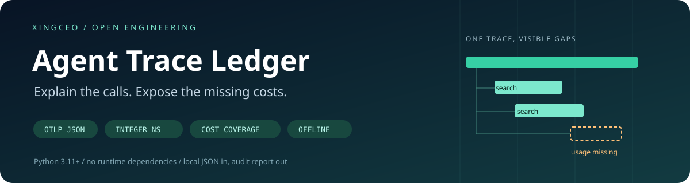
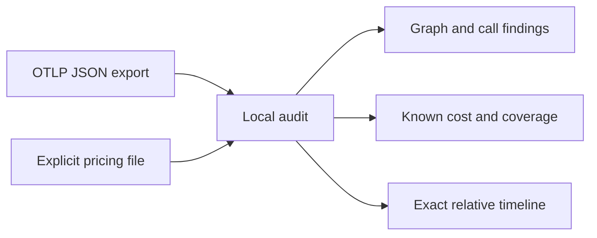

<div align="center">



[](https://github.com/XingCEO/agent-trace-ledger/actions/workflows/ci.yml)


[](LICENSE)


**Turn an exported agent trace into an honest, reproducible audit report.**

[Quickstart](#quickstart) · [OTLP mapping](#supported-otlp-json) · [Sample report](examples/otlp-output.json) · [Python API](#python-api) · [Limits](#scope-and-limits)

</div>

## The problem

A successful agent run can still contain overlapping identical tool calls, broken parent links, or model spans whose token usage was never recorded. A cost total that silently treats missing counters as zero makes those gaps harder to see.

Agent Trace Ledger reads a local **OTLP JSON trace export** or a small normalized span file. It emits a deterministic JSON audit containing trace-scoped graph findings, repeated-call review signals, exact relative timing, and a priced subtotal with explicit coverage. It fits into a bug report, a CI artifact, or another agent's debugging workflow.

| Audit | What you get |
| --- | --- |
| Trace graph | Missing parents and parent cycles; IDs scoped by trace, across resources and scopes. |
| Repeated calls | Same trace + tool name + recorded arguments; exact overlap count and bounded examples. |
| Token costs | Decimal arithmetic, explicit currency/rates, and reasons for every unpriced or partly priced model span. |
| Timeline | Per-trace origin, offsets and durations as integer nanosecond strings; resource service and instrumentation scope. |



## Quickstart

Requires Python 3.11+. The analyzer has **no runtime dependencies** and makes no network requests.

```bash
git clone https://github.com/XingCEO/agent-trace-ledger.git
cd agent-trace-ledger
python3 -m agent_trace_ledger examples/otlp.json --rates examples/rates.json
```

Install the console command from this checkout:

```bash
python3 -m venv .venv
. .venv/bin/activate
python -m pip install .
agent-trace-ledger examples/otlp.json --rates examples/rates.json > report.json
```

The [synthetic example](examples/otlp.json) contains two traces across two resources. It deliberately reuses a span ID in another trace, overlaps two search calls, omits one output-token counter, and references a parent that is absent from the export. The report shows:

```text
spans:                  7, across 2 traces
repeated tool groups:   1, with 1 overlapping pair
missing parents:        1
known token subtotal:   0.00046 USD
cost coverage:          incomplete — one model span lacks output usage
```

All example prices and model names are fictional. The subtotal includes recorded, priced input usage from the incomplete span; it is not a claim about the full run's bill.

## Supported OTLP JSON

The importer accepts **one JSON object** in the trace `ExportTraceServiceRequest` shape:

```text
resourceSpans[]
  resource.attributes[]                       service.name
  scopeSpans[]
    scope.name
    spans[]
      traceId / spanId / parentSpanId
      name / startTimeUnixNano / endTimeUnixNano
      attributes[]                            key + typed AnyValue
```

OTLP trace IDs use 32 hexadecimal characters and span IDs use 16; upper/lowercase input is canonicalized to lowercase. Parent IDs belong to the same trace. Omit an absent parent or use an empty string. Invalid or duplicate IDs within a trace fail validation. Numeric nanosecond timestamps and their protobuf decimal-string form are accepted as unsigned 64-bit integers. **The importer never converts them to floating point.**

Recognized [GenAI conventions](https://github.com/open-telemetry/semantic-conventions-genai/tree/main/docs/gen-ai):

| Attribute | Interpretation |
| --- | --- |
| `gen_ai.operation.name` | `chat`, `generate_content`, `text_completion`, `embeddings` classify model spans; `execute_tool` classifies tool spans. |
| `gen_ai.response.model` | Exact price lookup key; falls back to `gen_ai.request.model` when absent. |
| `gen_ai.usage.input_tokens`, `gen_ai.usage.output_tokens` | Nonnegative integer counts. Missing/null counters stay unknown; explicit zero is valid. |
| `gen_ai.tool.name` | Required nonempty name for an `execute_tool` span. |
| `gen_ai.tool.call.arguments` | Optional captured arguments. Missing arguments exclude that call from duplicate matching. |

Recognized attribute values support string, integer, finite double, boolean, arrays, key/value lists, and empty/null `AnyValue`. Binary `bytesValue` for analyzed attributes is rejected. Unknown attributes and other span fields are ignored. Custom/agent operations stay `other`, appear in `coverage.unclassified_span_count`, and do not contribute model costs; this avoids treating a parent agent's aggregate metadata as another model request.

Objects are compared with sorted keys. Strings remain opaque: a JSON string and a decoded object are distinct, and two JSON strings with different whitespace do not match. Explicitly recorded `{}` or null arguments can match; absent arguments cannot.

**Format boundaries:** no binary protobuf, gzip, JSONL, legacy `instrumentationLibrarySpans`, direct provider API responses, or SDK console-export format. There is no exporter/collector integration in this release. See [fixture provenance](examples/README.md) for the schema check and evidence boundary.

## Pricing and coverage

Provide [a separate rate file](examples/rates.json) with a currency label and prices **per million tokens**:

```json
{
  "currency": "USD",
  "models": {
    "demo-small": {"input": "0.20", "output": "0.80"}
  }
}
```

Price lookup uses exact model names; there are no aliases or built-in vendor prices. `cost.known_subtotal` sums only components with **both** a recorded counter and a supplied price. `cost.complete` describes coverage of recognized model spans in this file. Check `model_span_count` and `coverage` as well; an export without recognized model spans has no model-cost evidence.

`cost.incomplete_spans` records missing model, input/output counters and input/output rates. A price missing for an explicitly zero count remains a coverage gap. Use decimal strings for prices; up to 30 coefficient digits and exponent magnitude 30 are accepted. Caching discounts, batch tiers, image/audio units, tool fees and provider-specific billing rules need a separate billing model.

## CI and command behavior

```bash
agent-trace-ledger run.json --rates rates.json --fail-on graph > report.json
agent-trace-ledger run.json --rates rates.json --fail-on incomplete-cost > report.json
cat run.json | agent-trace-ledger - --max-findings 20 > report.json
```

| Exit | Meaning |
| --- | --- |
| `0` | Analysis completed and the selected gate passed; default `--fail-on never`. |
| `1` | Analysis completed and the selected gate failed; the JSON report is still written. |
| `2` | Invalid input, exceeded limits or unreadable file; diagnostic goes to stderr. |

`--fail-on any` gates on graph findings, incomplete costs, or repeated calls. Repeated calls are often legitimate, so choose this policy deliberately. `--format auto` detects `resourceSpans` versus normalized `spans`; both together are ambiguous. Use `--format otlp` or `normalized` to choose explicitly. See `--help` for all options.

Each CLI input/rate file is capped at **32 MiB**, and the default span limit is **10,000**. `--max-spans` changes the span limit; the byte limit remains fixed. Diagnostics default to **100 entries per category**. `--max-findings` caps graph findings, incomplete-cost entries, repeated groups, references within each group/cycle, and overlap samples. Counts and `truncated` flags expose omitted entries. Timelines include every accepted span. Parent traversal is iterative; overlap counting uses a sweep rather than materializing every pair.

## Python API

```python
import json
from agent_trace_ledger import analyze

with open("examples/otlp.json", encoding="utf-8") as stream:
    trace = json.load(stream)
with open("examples/rates.json", encoding="utf-8") as stream:
    pricing = json.load(stream)

report = analyze(trace, rates=pricing["models"], currency=pricing["currency"],
                 max_spans=10_000, max_findings=20)
assert report["cost"]["complete"] is False
```

The API returns a JSON-serializable dictionary and raises `ValueError` for invalid supported input. API callers supply already-parsed objects and manage their own file-byte limits. Avoid parsing OTLP nanosecond fields through floating point in an upstream adapter.

The compact normalized format in [examples/input.json](examples/input.json) remains available for custom adapters: `spans[]` contain `id`, optional `trace_id` (default `local`), optional same-trace `parent`, `kind` (`llm`/`tool`/`other`), and `start_ms`/`end_ms`. Tool spans add `name` and optional `arguments`; model spans add `model` and optional input/output counters. Embedded `rates` and `currency` are supported. Supply millisecond timestamps as decimal strings when precision matters; sub-nanosecond values are rejected.

**v0.2 migration:** normalized input remains supported, but the report changed. `estimated_cost` becomes `cost.known_subtotal` plus explicit coverage; graph/repeat arrays now have counts and truncation metadata; span references use `trace_id/span_id`. The versioned JSON interface is experimental.

## Validation

```bash
python3 -m unittest discover -v

# Optional development-only schema check using official protobuf classes:
python3 -m pip install ".[interop]"
python3 scripts/check_otlp_schema.py
```

Tests cover real import structure, cross-trace ID reuse, missing-versus-zero usage, partial rates, one-nanosecond precision at epoch scale, parent cycles/chains, bounded diagnostics, sweep counts against a brute-force oracle, CLI gates and installed examples. CI runs on Python 3.11 and 3.13 and exercises the installed command outside the checkout. These are synthetic tests, not evidence of live provider compatibility or production deployment.

## Scope and limits

Missing parents can be caused by sampling or an incomplete export; they are not automatically instrumentation failures. Identical tool calls are review signals, not proven retries or retry loops. Clock skew across services is not corrected. The report covers only the spans supplied, not an entire distributed run or provider invoice. Tool arguments are included in reports when captured, so use synthetic/redacted traces for public bug reports.

## Related work and contribution

[OpenTelemetry](https://opentelemetry.io/docs/specs/otlp/#json-protobuf-encoding) defines the transport and conventions. [Langfuse](https://github.com/langfuse/langfuse) and other observability systems address broader online trace workflows. This is an independent implementation of a small offline audit workflow; it does not claim novelty for graph checks or token arithmetic.

Useful contributions include synthetic fixtures that reproduce a concrete import mismatch, counter-coverage bug or graph issue. See [CONTRIBUTING.md](CONTRIBUTING.md).

[MIT](LICENSE) © 2026 XingCEO.
