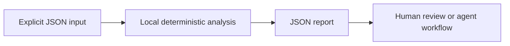

<div align="center">


[](https://github.com/XingCEO/agent-trace-ledger/actions/workflows/ci.yml)

[](LICENSE)


**Find retry loops, orphan spans and hidden token costs in offline agent traces.**

[Try it](#quickstart) · [Input contract](#input-contract) · [Example report](examples/output.json) · [Contribute](CONTRIBUTING.md)

</div>

## The problem

Agent traces often span several providers. A successful final answer can hide repeated calls, orphaned spans and large retry costs.

## How it works

Normalize provider exports into a small span contract. The analyzer checks the parent graph for cycles and missing parents, groups identical tool calls by canonical JSON, detects overlapping calls, and calculates model costs using explicit per-million-token rates. Decimal arithmetic keeps billing estimates reproducible.



## Quickstart

Requires Python 3.11 or later. The analyzer has **no runtime dependencies**, makes no network requests and runs no shell commands. Domain-specific interpretation (such as SQL rehearsal) is described below.

```bash
git clone https://github.com/XingCEO/agent-trace-ledger.git
cd agent-trace-ledger
python3 -m agent_trace_ledger examples/input.json
```

Optional installation into an isolated environment:

```bash
python3 -m venv .venv
. .venv/bin/activate
python -m pip install .
agent-trace-ledger examples/input.json
```

The package is installed from this checkout; no PyPI publication is claimed.

## Input contract

Use [the complete example](examples/input.json) as a starting point. Paths and strings in JSON are data unless the contract explicitly says they refer to local files.

| Field | Meaning |
| --- | --- |
| `spans` | Array of id, optional parent, kind, start_ms and end_ms; tool spans add name/arguments, llm spans add model and token counts. |
| `rates` | Optional model → input/output prices per million tokens in one chosen currency. |

## Example result

Generated by running the committed example:

```json
{
  "estimated_cost": "0.00036",
  "graph_findings": [],
  "repeated_calls": [
    {
      "arguments": {
        "q": "retry"
      },
      "overlaps": [],
      "spans": [
        "b",
        "c"
      ],
      "tool": "search"
    }
  ],
  "span_count": 3,
  "unpriced_spans": []
}
```

## Use from another tool

```python
import json
from agent_trace_ledger import analyze

with open("examples/input.json", encoding="utf-8") as stream:
    report = analyze(json.load(stream))
```

`analyze(data)` returns a JSON-serializable dictionary. The CLI accepts `-` for stdin, writes reports to stdout and input errors to stderr. Exit `0` means analysis completed, including reports containing findings; exit `2` means invalid input or an unreadable file. Gate CI on the report's documented fields, rather than assuming exit `0` means no findings. The JSON report is a v0.1 interface and may evolve before 1.0.

## Validation

```bash
python3 -m unittest discover -v
```

Tests cover the example, malformed CLI input, and the domain-specific boundary cases in [tests/test_core.py](tests/test_core.py). CI also installs the package and runs its console entry point on Python 3.11 and 3.13. Test success demonstrates these cases; it is not evidence of production deployment.

## Scope and limits

Input is a normalized export, not a provider SDK or collector. Repeated arguments are a review signal, not proof of a bug. Cost estimates exclude caching, tiers and non-token fees unless reflected in supplied rates. Timestamps are numeric milliseconds on one common clock.

This is a focused experimental first release. Review findings before changing production systems. Inputs and reports may contain your own source or metadata; keep them in an appropriate local workspace.

## Related work and references

- [OpenTelemetry traces](https://opentelemetry.io/docs/concepts/signals/traces/)
- [Langfuse](https://github.com/langfuse/langfuse)

These projects and specifications inform the problem space. This repository is an independent implementation; it does not claim to replace the referenced systems or to have invented the underlying techniques.

## Contributing

A small real-world fixture with expected behavior is the most useful contribution. See [CONTRIBUTING.md](CONTRIBUTING.md). Please remove private data before filing an issue.

## License

[MIT](LICENSE) © 2026 XingCEO.
